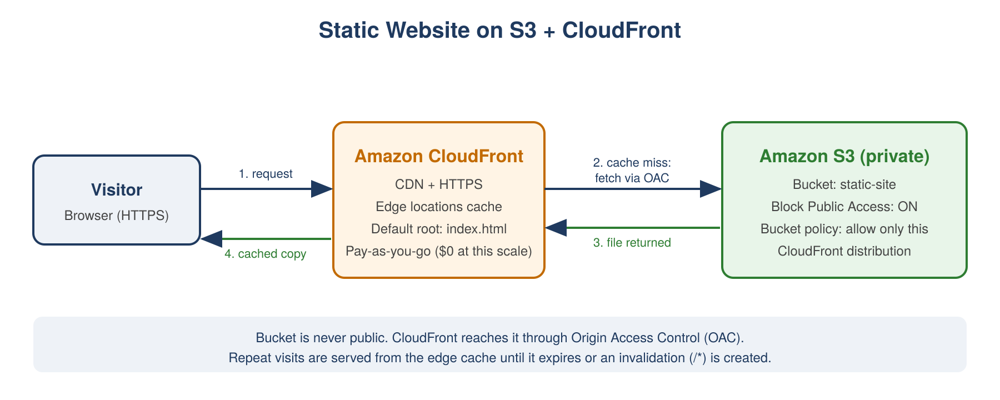

# Static Website on S3 + CloudFront

A private S3 bucket serving a static website globally over HTTPS through Amazon CloudFront.

## Problem
Host a static website cheaply, securely and fast for visitors anywhere, with no servers to manage.

## Architecture
| Component | Role |
|---|---|
| **Amazon S3** | Stores `index.html`. The bucket is **private** (Block Public Access ON). |
| **Amazon CloudFront** | Serves the site over HTTPS from edge locations and caches it near visitors. |
| **Origin Access Control (OAC)** | Lets only this CloudFront distribution read the bucket. |
| **Bucket policy** | Allows `s3:GetObject` for the CloudFront service principal, scoped to this distribution's ARN. |

**Request flow:** visitor → CloudFront (HTTPS) → on a cache miss, CloudFront fetches the object from S3 using OAC → the file is cached at the edge and returned. Repeat visits are served from the cache.

## Design decisions
- **Private bucket + OAC instead of S3 public website hosting.** The bucket is never exposed; the only public entry point is CloudFront. This also gives HTTPS, which S3 website endpoints do not.
- **CloudFront caching** reduces S3 requests and lowers latency for users far from the bucket's region (us-east-2).
- **Default root object `index.html`** so the bare domain serves the page.
- **No WAF** on this learning site: the estimated cost was about $14 per 10M requests plus fixed charges, and it adds nothing for a static page with no inputs. For a real production site, I would enable AWS WAF.

## Deploy (console)
1. Create an S3 bucket with **Block all public access ON** and upload `index.html`.
2. Create a CloudFront distribution with the bucket as an S3 origin, and choose **Allow private S3 bucket access to CloudFront** (OAC).
3. Set **Default root object** to `index.html`.
4. Confirm the bucket policy references the distribution's ARN.
5. Open `https://<distribution-domain>.cloudfront.net`.

## Cache behavior test
1. Edit `index.html` and re-upload it. The site still shows the old text (served from the edge cache).
2. Create a CloudFront **invalidation** for `/*`.
3. After a minute, the new content appears.

## Troubleshooting I hit
- **AccessDenied (XML) on the bare domain:** the default root object was not set. S3 returns AccessDenied instead of "not found" when the object key does not exist and the caller has no `ListBucket` permission. Setting the root object to `index.html` fixed it.
- **File worked at `/index.html` but not at `/`:** same cause.

## Cost
About **$0**. CloudFront's pay-as-you-go free tier covers 1 TB of data out and 10M requests per month, and S3 storage for one 183-byte file is negligible. No custom domain, no WAF.

## Teardown
Disable the distribution, wait for it to finish, delete it, then empty and delete the bucket.

## What I learned
- How a CDN, edge locations and caching reduce latency and origin load.
- Why OAC and a scoped bucket policy are the secure way to serve a private bucket.
- How stale cache happens, and how invalidations fix it.
